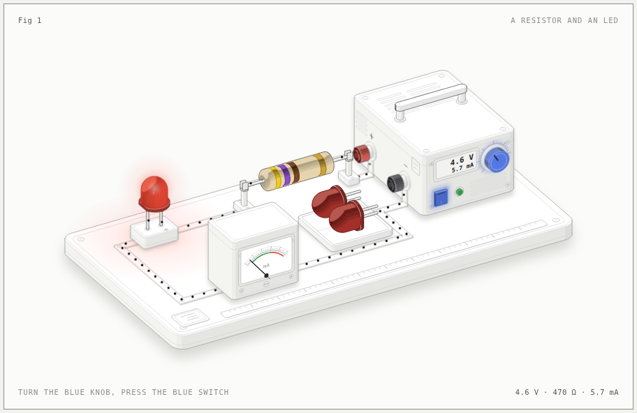
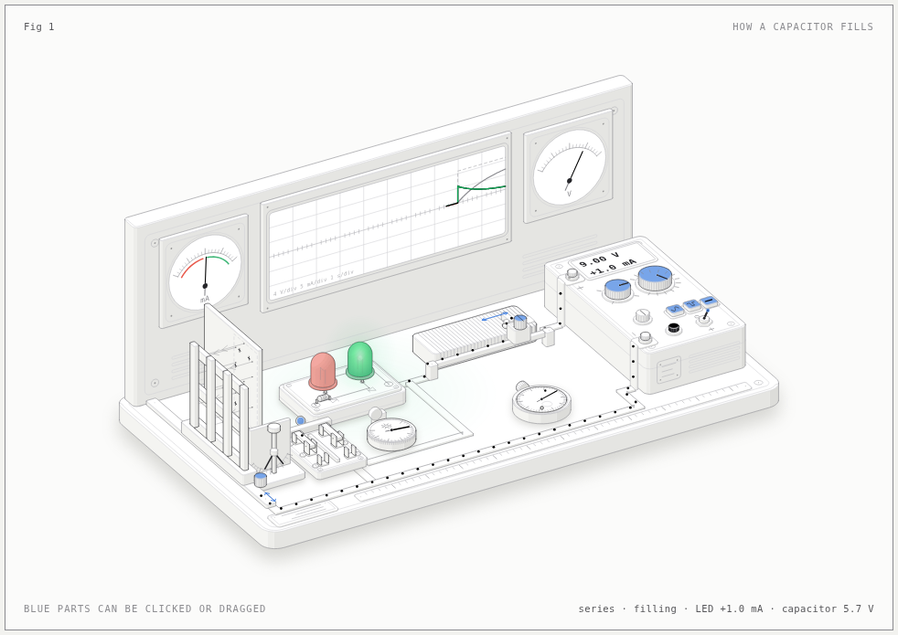
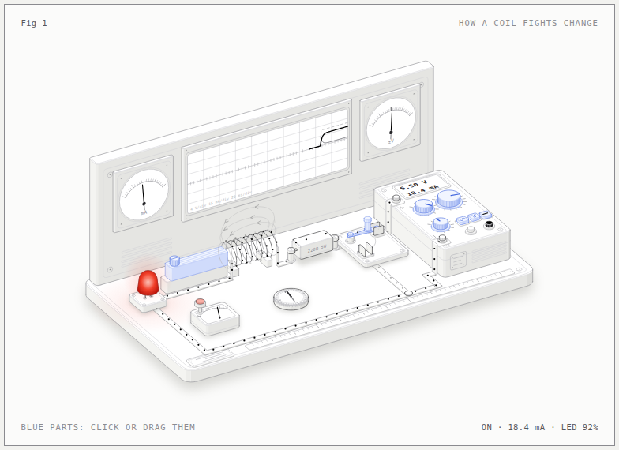
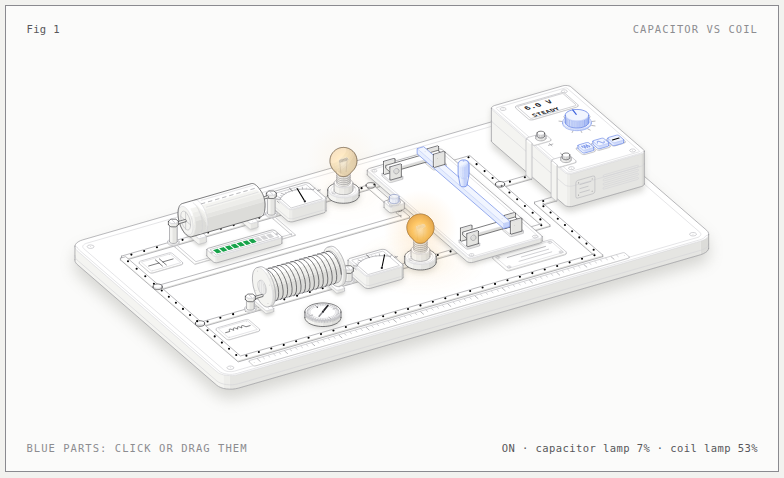
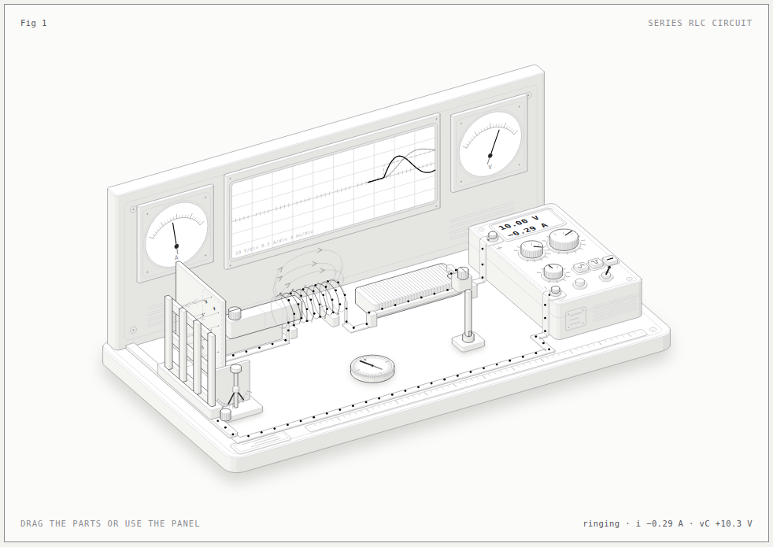

# Electronics figures

Five interactive drawings that show how simple electronic parts behave. Each one is a little workbench you can play with: turn knobs, flip switches, and watch the current move, the lamps glow and the meters swing.

They are written for curious beginners, including kids in elementary school. Every number on the screen comes from a real physics model of the circuit, so what you see is what the circuit would really do (sometimes slowed down so you can follow it).

**Play with them online:** https://renorega.github.io/electronics-figures/

> **Tip:** the parts coloured **blue** are the ones you can click or drag.

## The figures

### How a resistor works


A battery box, one resistor and an LED. Change the voltage or the resistor and see how much current flows, how bright the LED gets, and what happens when too much current burns it out.

[Play (light)](https://renorega.github.io/electronics-figures/resistor/resistor-light.html) · [Play (dark)](https://renorega.github.io/electronics-figures/resistor/resistor.html)

### Capacitor and LED


A capacitor is like a small tank for electricity. Watch it fill and empty through two LEDs: green while it fills, red while it empties. Switch between series and parallel wiring and see the circuit diagram follow along.

[Play (light)](https://renorega.github.io/electronics-figures/capacitor/capacitor-light.html) · [Play (dark)](https://renorega.github.io/electronics-figures/capacitor/capacitor.html)

### Inductor (coil)


A coil doesn't like sudden changes in current. Switch it on and the LED is slow to light up; switch it off and the coil keeps the LED glowing for a moment.

[Play (light)](https://renorega.github.io/electronics-figures/inductor/inductor-light.html) · [Play (dark)](https://renorega.github.io/electronics-figures/inductor/inductor.html)

### Capacitor vs coil


The two parts side by side on one bench, each with its own lamp. Use steady power or a slow or fast wiggle (AC) and compare how differently they react. The capacitor keeps its charge when you switch off; the coil makes a spark.

[Play (light)](https://renorega.github.io/electronics-figures/twins/twins-light.html) · [Play (dark)](https://renorega.github.io/electronics-figures/twins/twins.html)

### Series RLC circuit


A resistor (R), a coil (L) and a capacitor (C) in one loop. Energy sloshes back and forth between the coil and the capacitor, and the oscilloscope shows the current "ringing" and fading away. Change each part and see how the ringing changes.

[Play (light)](https://renorega.github.io/electronics-figures/rlc/rlc-light.html) · [Play (dark)](https://renorega.github.io/electronics-figures/rlc/rlc.html)

## How the project is organised

```
resistor/  capacitor/  inductor/  twins/  rlc/   one folder per figure
  model.mjs     the physics: works out every voltage and current
  world.mjs     where each part sits on the bench
  build.mjs     draws the parts and puts the page together
  panel.mjs     the control panel and the explanations
  live.js       the animation and everything you can click
  <name>.html, <name>-light.html   the finished pages (dark and light)
shared/        the drawing toolkit that all figures use
images/        the pictures in this README
```

The finished `.html` pages need nothing else. You can download one and open it in any web browser, even without internet.

## Rebuilding a page

If you change a figure's code, rebuild its pages with [Node.js](https://nodejs.org):

```sh
cd resistor
node build.mjs           # dark page
node build.mjs --light   # light page
```

## Credits

These figures were made with the help of [**Anatomy**](https://skills.wheresryan.sh/anatomy), a Claude Code skill by wheresryan for building interactive isometric figures. If you'd like to make figures like these yourself, start there.

The isometric drawing toolkit in `shared/` comes from the Anatomy skill and is used under its MIT license (see `shared/kit/LICENSE`). Everything else is under the MIT license in `LICENSE`.
